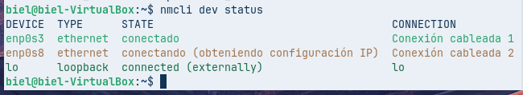
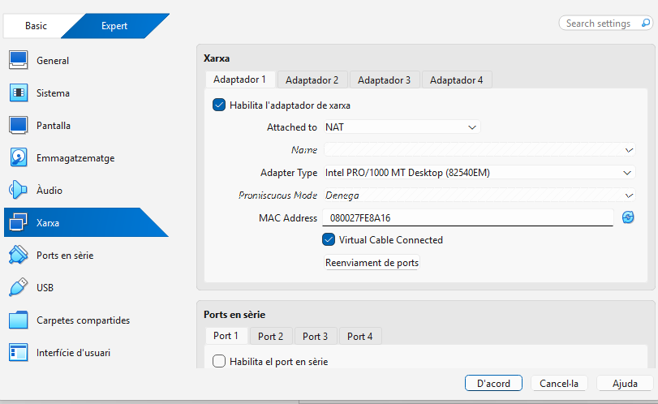
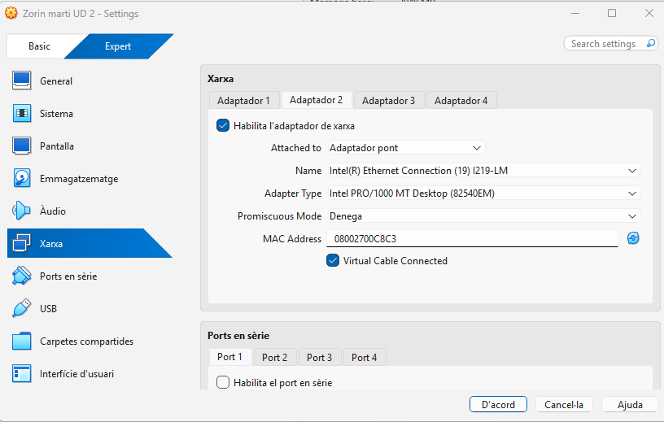
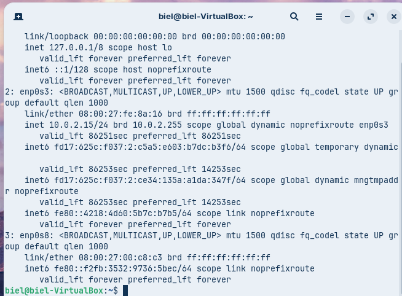
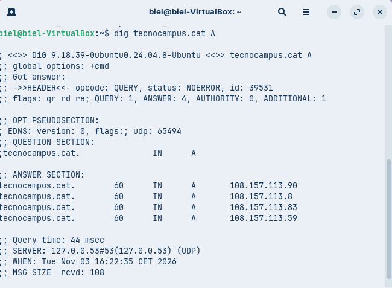
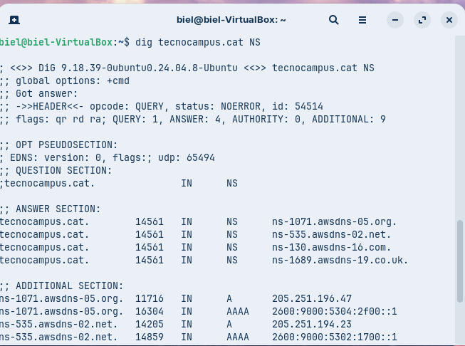
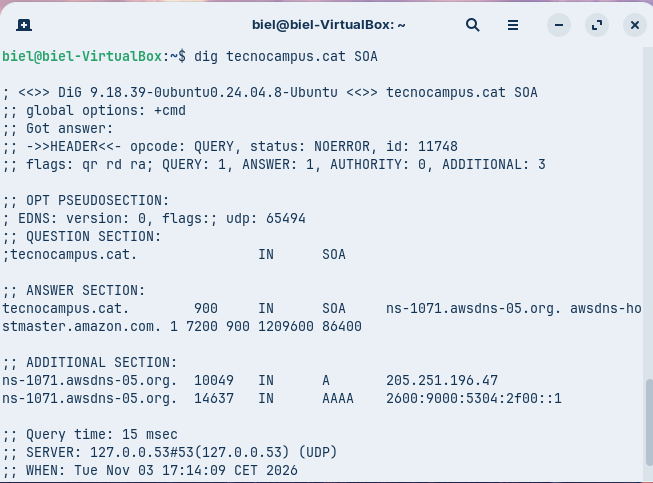
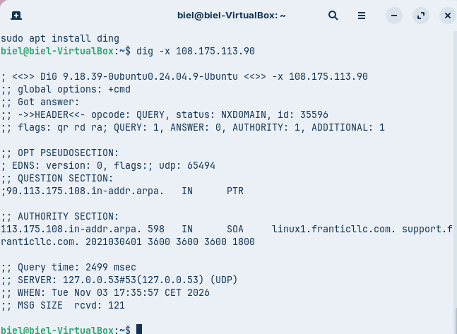
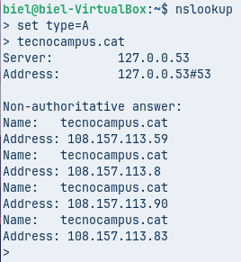
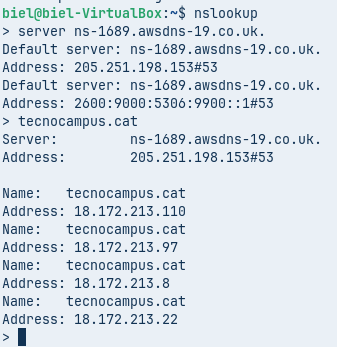

# Video

## Què és el DNS?

- Sistema de Noms de Domini
- Relaciona noms amb adreces IP
- Facilita l'accés als serveis
- Exemple: www.google.com → adreça IP

## Com es registra un nom de domini?

- Escollir un nom
- Comprovar si està disponible
- Registrar-lo
- Configurar els servidors DNS
- Crear els registres DNS

## Arquitectura DNS

Client

   ↓

Servidor DNS recursiu

   ↓

Root Server

   ↓

Servidor TLD

   ↓

Servidor autoritatiu

## Estructura jeràrquica del DNS
A la diapositiva:
.
└── es
    └── exemple
        └── www

Arrel → TLD → Domini → Subdomini/host

## Com funciona la resolució de noms?

Nom de domini
      ↓
DNS recursiu
      ↓
Root Server
      ↓
Servidor TLD
      ↓
Servidor autoritatiu
      ↓
Adreça IP

## Consultes recursives i iteratives

Consulta recursiva
El servidor busca la resposta completa.
Consulta iterativa
El servidor indica on continuar buscant.

I també:
- Root Server → indica el TLD
- Servidor autoritatiu → resposta oficial

## Zones DNS

ZONES DNS

Zona directa
Nom → IP

Zona inversa
IP → Nom

Zona primària
Informació principal

Zona secundària
Còpia de la informació

## mDNS
A la diapositiva:
mDNS
- Xarxa local
- Multicast
- Noms .local
- UDP 5353
- 224.0.0.251
Exemple:
Ordinador
    ↓
"Qui és impressora.local?"
    ↓
Xarxa local
    ↓
Impressora
    ↓
"Soc jo"

## Mapa conceptual i resum

### Ellaços:

Enllç de la informacio: https://docs.google.com/presentation/d/1pI3yj6M9EfkxkN-0H9V3bTXzSPc_2zIi/edit?slide=id.p1#slide=id.p1

Enllç de la informacio: https://chatgpt.com/c/6ae8e05f-7ef0-83eb-b042-188af24855d4

# AUDITORIA DE RESOLUCIÓ DE NOMS

### Sistema operatiu: màquina virtual amb Zorin OS (o una distribució Linux equivalent).
### Configuració de xarxa:

### - Interfície 1 (eth0 / enp0s3): mode NAT.
### - Interfície 2 (eth1 / enp0s8): mode Adaptador pont (Bridged) amb IP estàtica.

## PART A. DIAGNOSI AMB DIG

## Consulta bàsica de registre A

### dig tecnocampus.cat A

### Anàlisi: Identifiqueu la IP de resposta, el valor del TTL i la IP del servidor DNS que ha respost.

La IP de resposta és 108.157.113.90.

El valor del TTL és 60.

El servidor DNS que ha respost és 127.0.0.53.

## Consulta de servidors de noms (NS)

### dig tecnocampus.cat NS

### Anàlisi: Indiqueu quins són els servidors de noms (Name Servers) autoritatius per a aquest domini.

Els servidors de noms autoritatius per a tecnocampus.cat són:

ns-1071.awsdns-05.org.
ns-535.awsdns-02.net.
ns-130.awsdns-16.com.
ns-1689.awsdns-19.co.uk.

## Consulta detallada SOA

### dig tecnocampus.cat SOA

### Anàlisi: Identifiqueu el correu de l'administrador (rname) i el número de sèrie (serial) del domini.

rname: awsdns-hostmaster.amazon.com → correspon al correu de l’administrador de la zona.
serial: 1 → és el número de sèrie actual de la zona DNS.

## Consulta de resolució inversa

### dig -x <IP_obtinguda_a_la_comanda_1>

### Anàlisi: Detalleu quina informació s'obté dels registres PTR i a quin nom de domini resol la IP introduïda.

IP consultada: 108.175.113.90

Registro PTR: No se obtiene ningún registro PTR (status: NXDOMAIN).

La IP no resuelve a ningún nombre de dominio.

## PART B. COMPROBACIÓ AMB NSLOOKUP

## Consulta bàsica no autoritativa

### Abrir nslookup en modo interactivo y ejecutar:

### set type=A

### tecnocampus.cat

### Anàlisi: Analitzeu la resposta obtinguda i indiqueu per què la consola especifica que la resposta és no autoritativa (Non-authoritative answer).

La resposta és Non-authoritative perquè el servidor DNS local (127.0.0.53) no és autoritatiu del domini. Ens ha donat la informació de la seva caché o resolent-la a través d’altres servidors, no directament dels nameservers oficials de tecnocampus.cat.

## Consulta autoritativa directa

### Canvieu el servidor DNS pel primer servidor autoritatiu obtingut a la Comanda 2.

### Executeu novament la consulta del registre A per a tecnocampus.cat.

### Compareu la resposta amb la de la Comanda 5 i confirmeu si l'indicador "no autoritatiu" ha desaparegut.

Servidor utilitzat: ns-1689.awsdns-19.co.uk

IPs que retorna: 18.172.213.110, 18.172.213.97, 18.172.213.8, 18.172.213.22

Ha desaparegut “Non-authoritative answer”? Sí.

Comparació amb el punt 5:
Al punt 5 apareix “Non-authoritative answer” i retorna les IPs 108.157.113.59, 108.157.113.8, 108.157.113.90 i 108.157.113.83.
En la consulta directa al servidor autoritatiu aquest indicador desapareix i les IPs són diferents.